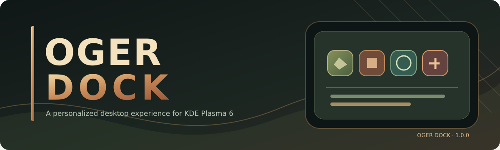

<p align="center"></p>
<h1 align="center">Oger Dock</h1>
<p align="center"><strong>Make KDE Plasma your own.</strong></p>
<p align="center">
  <a href="https://github.com/dsrsouza/Oger-Dock/releases"></a>
  
  
  <a href="LICENSE"></a>
</p>

<p align="center"><strong>Application launchers · Live windows · Fan folders · MPRIS media controls · Native KDE integration</strong></p>
<p align="center"><a href="README.md">English</a> | <a href="README.pt_BR.md">Português (Brasil)</a></p>

**Oger Dock** brings a smooth, configurable application dock to **KDE Plasma 6**. It combines shortcuts, window switching, interactive folders, a compact media player and desktop utilities in a cohesive experience. Designed and tested primarily with **openSUSE Tumbleweed, KDE Plasma 6.8.2 and Wayland**, version **1.0.0** continues the R63.7 functional baseline.

> [!IMPORTANT]
> The complete Oger Dock 1.0.0 source is now available in this repository. ZIP/TAR.GZ source installers are available under [Releases](https://github.com/dsrsouza/Oger-Dock/releases). These packages compile locally; they are not universal prebuilt `.plasmoid` binaries.

[Features](#features) · [Gallery](#gallery) · [Installation](#installation) · [Compatibility](#compatibility) · [Testing](#testing-and-quality) · [Community](#community-and-support) · [License](#license)

<p align="center"></p>

## Features

### Applications and windows
- **Launchers and favorites:** keep frequently used apps pinned and organize shortcuts.
- **Mouse-wheel switching:** move sequentially between eligible open apps, honoring direction and stopping at the ends instead of skipping.
- **Running-app indicators:** visual state for open and focused windows.
- **Reorder items:** unlock the dock to rearrange application icons and folders.

### Fan folders and collections
- **Animated fan folders:** open collections without interrupting the dock layout.
- **Per-folder colors:** set names and independent accents or use category/theme defaults.
- **Application picker:** find installed apps by name or category and add multiple items to collections.

### OgerMenu
- **Normal and Reduced modes:** choose the presentation that matches your workspace.
- **Search and categories:** find installed applications without opening another launcher.
- **KDE session actions:** shutdown, restart and logout through KDE-supported operations.

### Media and desktop tools
- **MPRIS mini player:** artwork, previous, play/pause and next for active compatible players.
- **Expanding track details:** reveal title and artist without shifting fixed playback controls.
- **Trash:** open in Dolphin, empty with confirmation, and access common actions.

### Appearance, tray and interactions
- **Positions:** bottom (default), left or right; top placement is intentionally unavailable.
- **KDE look and feel:** configurable appearance, smooth animation and running indicators.
- **SNI/DBusMenu support:** compatible tray apps can expose their real menus and reuse existing processes.
- **Startup-aware behavior:** tray-only autostart apps do not gain a dock entry solely by registering an SNI.
- **R63.7 scroll fix:** prevents unintended activation or promotion of tray-only apps such as MEGAsync when using the dock's wheel navigation.

Tray behavior depends on the application's exported SNI and the windows recognized by KDE; not every third-party popup can be managed by the dock.

## Gallery

Real screenshots are reserved for this gallery for the bottom and side dock, the Normal/Reduced menus, fan folders, player and settings. The [screenshot guide](docs/SCREENSHOTS.md) documents the expected images; no images from another dock are presented as Oger Dock captures.

## Installation

### GitHub release — source installer

Download the ZIP or TAR.GZ from [Releases](https://github.com/dsrsouza/Oger-Dock/releases), extract the archive, and run the included installer **inside the extracted project folder**. A C++/Qt6/KF6 build takes place on your machine; this is **not** a universal binary package.

### Build dependencies by distribution

Native compilation needs **CMake 3.22+, a C++20 compiler, Qt 6.6+, KDE Frameworks 6, Plasma/PlasmaQuick 6, Plasma Activities/ActivitiesStats, LibKWorkspace, PipeWire 0.3 headers, ECM, Gettext and the Qt Shader Baker (`qsb`)**. These dependencies come from the actual Oger Dock 1.0.0 CMake files.

Choose **one** command matching your distribution. Package names and versions can change between releases; these are source-build package lists, **not** a claim that the final release has been tested on every distribution.

<details>
<summary>openSUSE Tumbleweed / Leap with compatible Plasma 6</summary>

```bash
sudo zypper refresh
sudo zypper install \
  binutils cmake make gcc-c++ kf6-extra-cmake-modules gettext-tools git pkgconf-pkg-config \
  qt6-base-devel qt6-declarative-devel qt6-shadertools \
  kf6-kconfig-devel kf6-kcoreaddons-devel kf6-kglobalaccel-devel \
  kf6-ki18n-devel kf6-kjobwidgets-devel kf6-kio-devel \
  kf6-kpackage-devel kf6-kservice-devel kf6-kwindowsystem-devel \
  libplasma6-devel plasma6-workspace-devel \
  plasma6-activities-devel plasma6-activities-stats-devel \
  pipewire-devel unzip zip
```

</details>

<details>
<summary>Fedora KDE</summary>

```bash
sudo dnf install \
  binutils cmake make gcc-c++ extra-cmake-modules gettext git pkgconf-pkg-config \
  qt6-qtbase-devel qt6-qtdeclarative-devel qt6-qtshadertools \
  kf6-kconfig-devel kf6-kcoreaddons-devel kf6-kglobalaccel-devel \
  kf6-ki18n-devel kf6-kjobwidgets-devel kf6-kio-devel \
  kf6-kpackage-devel kf6-kservice-devel kf6-kwindowsystem-devel \
  libplasma-devel plasma-workspace-devel \
  plasma-activities-devel plasma-activities-stats-devel \
  pipewire-devel unzip zip
```

</details>

<details>
<summary>Debian / Ubuntu / Kubuntu / KDE neon with Plasma 6</summary>

```bash
sudo apt update
sudo apt install \
  binutils build-essential cmake extra-cmake-modules gettext git pkg-config \
  qt6-base-dev qt6-base-dev-tools qt6-declarative-dev \
  qt6-declarative-dev-tools qt6-shader-baker \
  libkf6config-dev libkf6coreaddons-dev libkf6globalaccel-dev \
  libkf6i18n-dev libkf6jobwidgets-dev libkf6kio-dev \
  libkf6package-dev libkf6service-dev libkf6windowsystem-dev \
  libplasma-dev plasma-workspace-dev \
  libplasmaactivities-dev libplasmaactivitiesstats-dev \
  libpipewire-0.3-dev unzip zip
```

</details>

<details>
<summary>Arch Linux / Manjaro with compatible Plasma 6</summary>

```bash
sudo pacman -Syu --needed \
  base-devel binutils cmake extra-cmake-modules gettext git pkgconf \
  qt6-base qt6-declarative qt6-shadertools \
  kconfig kcoreaddons kglobalaccel ki18n kjobwidgets kio \
  kpackage kservice kwindowsystem \
  libplasma plasma-workspace plasma-activities plasma-activities-stats \
  pipewire unzip zip
```

</details>

After installing the packages, run `bash scripts-user/setup.sh --check-deps` in the **complete extracted source directory**. **Important:** the current script checks only a **subset** of the CMake dependencies, especially on openSUSE; a successful check does not guarantee that every required package is present. CMake will report any additional missing components during the build.

For explanations and troubleshooting, see [the full installation guide](docs/INSTALLATION.md).

### Build from source

Clone the complete source tree:

```bash
git clone https://github.com/dsrsouza/Oger-Dock.git
cd Oger-Dock
bash scripts-user/setup.sh --check-deps
bash scripts-user/setup.sh --build-only -j 2
bash scripts-user/setup.sh --install --no-restart -j 2
```

Run the commands as your regular desktop user. Then add **Oger Dock** from KDE Plasma's **Add Widgets** menu; log out and back in when required to reload the native module. **Do not remove existing configuration when updating.**

For distro dependencies and troubleshooting, use the [English installation guide](docs/INSTALLATION.md) or [Brazilian Portuguese guide](docs/INSTALACAO.pt_BR.md).

## Compatibility

| Platform | Status |
|---|---|
| openSUSE Tumbleweed / KDE Plasma 6.8.2 / Wayland | Primary development and user-test environment |
| Other Linux distributions with compatible KDE Plasma 6 | Targeted, but requires native build and testing |
| Fedora KDE | Installation instructions available; release validation pending |
| Debian / Ubuntu KDE | Installation instructions available; release validation pending |
| Desktops without KDE Plasma | Unsupported |

The **public name** is Oger Dock. The technical Plasma applet ID `org.kde.plasma.punchi-dock-remastered` remains unchanged for settings and update compatibility. Native modules may need rebuilding following KDE/Qt library updates.

## Testing and quality

The 1.0.0 release preparation reported **11/11 targeted regression checks** and **13/13 shell syntax checks** passing. These are offline checks, **not** proof of a native build or end-to-end certification on every distribution. In the R63.7 baseline, the fix preventing MEGA's unintended activation during scroll was confirmed by the maintainer in KDE Plasma.

Details: [Release notes](docs/RELEASE-1.0.0.md) · [Architecture](docs/ARCHITECTURE.md) · [FAQ](docs/FAQ.md).

## Community and support

- **Questions, help and ideas:** [GitHub Discussions](https://github.com/dsrsouza/Oger-Dock/discussions) *(must be enabled in repository settings)*.
- **Bug reports and feature requests:** [GitHub Issues](https://github.com/dsrsouza/Oger-Dock/issues).
- **Contributions:** [Contributing guide](CONTRIBUTING.md) and [security policy](SECURITY.md).

When reporting an issue, include the distribution, KDE Plasma and Qt versions, Wayland/X11, installation method, reproduction steps and logs without private data.

<details><summary>Project source structure</summary>

```text
contents/       QML UI, JavaScript logic, images, configuration
src/            native C++ components
scripts-user/   dependency checks, build, packaging and installation
tests-dev/      targeted regression tests
po/             translations
metadata.json   Plasma applet metadata
AGENTS.md       development notes and AI guidance
```

</details>

### AI-assisted development

AI tools were used to support research, coding, regression analysis, tests and documentation. Maintainers are responsible for reviewing changes and validating behavior. The release history and agent guidance document the work; automated results do not replace hands-on testing.

## Credits

**Diego Souza.R**  
**Punchisoft**

Oger Dock is based on [Punchi Dock Remastered](https://github.com/PunchiSoft/punchi-dock-remastered), developed by **PunchiSoft**. Original source-file notices and attribution obligations remain applicable; see [NOTICE](NOTICE).

## License

Distributed under the [GNU General Public License v3.0 or later](LICENSE). See [NOTICE](NOTICE) and the original source notices. Preserve attribution and provide corresponding source code when distributing GPL-covered binaries.
