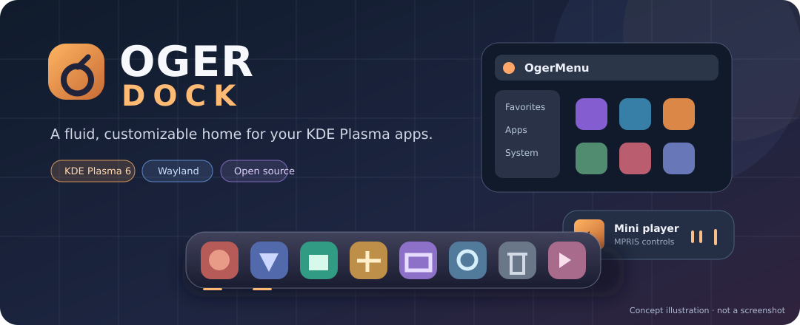

# Oger Dock

<p align="center"></p>
<p align="center">
  <a href="https://github.com/dsrsouza/Oger-Dock/releases"></a>
  
  
  <a href="LICENSE"></a>
</p>

<p align="center"><strong>Lançadores · Janelas abertas · Pastas em leque · Mini player MPRIS · Integração com KDE</strong></p>
<p align="center"><a href="README.md">English</a> | <a href="README.pt_BR.md">Português (Brasil)</a></p>

O **Oger Dock** é uma dock fluida e personalizável para o **KDE Plasma 6**, que reúne aplicativos fixados, alternância de janelas, pastas animadas, player multimídia e ferramentas da área de trabalho. A versão **1.0.0** preserva a base funcional R63.7, desenvolvida e testada principalmente no **openSUSE Tumbleweed, KDE Plasma 6.8.2 e Wayland**.

> [!IMPORTANT]
> O código-fonte completo está em preparação para importação neste repositório. Até a conclusão do processo, o clone contém somente documentação. O instalador ZIP/TAR.GZ que será publicado em [Releases](https://github.com/dsrsouza/Oger-Dock/releases) compila o plasmoide no computador do usuário — não é um binário `.plasmoid` universal.

[Recursos](#recursos) · [Galeria](#galeria) · [Instalação](#instalação) · [Compatibilidade](#compatibilidade) · [Testes](#testes-e-qualidade) · [Comunidade](#comunidade-e-suporte) · [Licença](#licença)

## Recursos

### Aplicativos e janelas
- **Lançadores e favoritos:** fixe aplicativos e organize os atalhos na dock.
- **Alternância pela roda do mouse:** percorra sequencialmente os aplicativos elegíveis, respeitando a direção e os limites da lista.
- **Indicadores de execução:** acompanhe visualmente quais aplicativos estão abertos e ativos.
- **Reorganização:** destrave a dock para mover ícones, pastas e outros itens.

### Pastas e coleções
- **Pastas em leque:** abra coleções com animação fluida e organização visual.
- **Cores individuais:** personalize o nome e a cor de cada pasta, mantendo padrões por categoria/tema.
- **Seletor de aplicativos:** pesquise por nome ou categoria e adicione vários programas às coleções.

### OgerMenu
- **Modos Normal e Reduzido:** duas apresentações adequadas a diferentes espaços de trabalho.
- **Pesquisa e categorias:** encontre rapidamente aplicativos instalados.
- **Ações de sessão KDE:** desligar, reiniciar e encerrar a sessão.

### Multimídia e utilitários
- **Mini player MPRIS:** capa e botões anterior, reproduzir/pausar e próximo para players compatíveis.
- **Informações expansíveis:** título e artista aparecem sem deslocar os controles fixos.
- **Lixeira:** abrir no Dolphin, esvaziar com confirmação e acessar ações comuns.

### Aparência, bandeja e interação
- **Posições:** inferior (padrão), esquerda ou direita; a posição superior não é oferecida.
- **Estilo integrado ao KDE:** aparência configurável, animações e indicadores visuais.
- **SNI/DBusMenu:** aplicativos compatíveis podem apresentar menus nativos e reutilizar processos abertos.
- **Respeito ao autostart:** programas da bandeja não ganham ícone na dock apenas por iniciar com o sistema.
- **Correção R63.7:** o scroll não ativa ou promove indevidamente programas exclusivos da bandeja, como o MEGAsync.

A integração depende das informações efetivamente fornecidas pelo aplicativo e pelo KDE TaskManager. Nem todo popup de terceiros pode ser controlado pela dock.

## Galeria

<p align="center"></p>
<p align="center"><em>Ilustração conceitual — não é uma captura de tela do aplicativo em execução.</em></p>

As capturas reais da dock inferior e lateral, menus Normal/Reduzido, pastas, player e configurações serão acrescentadas à galeria. O [guia de capturas](docs/SCREENSHOTS.md) especifica os arquivos esperados. Não utilizaremos imagens de outros projetos como se fossem do Oger Dock.

## Instalação

### Instalar a partir de uma release

Baixe o ZIP ou TAR.GZ em [Releases](https://github.com/dsrsouza/Oger-Dock/releases), extraia o pacote e execute o instalador **dentro da pasta extraída**. A instalação compila os componentes C++/Qt6/KF6 localmente; **não** há um plasmoide universal pré-compilado nesse pacote.

### Compilar pelo código-fonte

Assim que a importação do código-fonte estiver concluída:

```bash
git clone https://github.com/dsrsouza/Oger-Dock.git
cd Oger-Dock
bash scripts-user/setup.sh --check-deps
bash scripts-user/setup.sh --build-only -j 2
bash scripts-user/setup.sh --install --no-restart -j 2
```

Execute como usuário comum do desktop, não como root. Depois, em **Adicionar widgets** do KDE Plasma, escolha **Oger Dock**. Para carregar o módulo nativo atualizado, talvez seja necessário sair e entrar novamente na sessão. **Não apague as configurações existentes na atualização.**

Veja as dependências por distribuição no [guia em português](docs/INSTALACAO.pt_BR.md) e no [guia em inglês](docs/INSTALLATION.md).

## Compatibilidade

| Ambiente | Situação |
|---|---|
| openSUSE Tumbleweed / KDE Plasma 6.8.2 / Wayland | Principal ambiente de desenvolvimento e testes do usuário |
| Outras distribuições com KDE Plasma 6 compatível | Alvo previsto; requer compilação e validação |
| Fedora KDE | Instruções disponíveis; homologação da release pendente |
| Debian / Ubuntu KDE | Instruções disponíveis; homologação da release pendente |
| Ambientes sem KDE Plasma | Não suportados |

O **nome público** é Oger Dock. O identificador técnico `org.kde.plasma.punchi-dock-remastered` foi preservado para manter as preferências e a compatibilidade das atualizações. Mudanças em bibliotecas Qt ou Plasma podem exigir recompilação.

## Testes e qualidade

Na preparação da versão 1.0.0, foram registrados **11/11 testes de regressão direcionados** e **13/13 verificações de sintaxe Shell** aprovados. São verificações locais que **não** substituem compilação nativa nem testes completos em todas as distribuições. A correção da R63.7 que impede a ativação indevida do MEGA durante o scroll foi confirmada no KDE Plasma.

Mais informações: [Notas da versão](docs/RELEASE-1.0.0.md) · [Arquitetura](docs/ARCHITECTURE.md) · [Perguntas frequentes](docs/FAQ.md).

## Comunidade e suporte

- **Ajuda, dúvidas e ideias:** [GitHub Discussions](https://github.com/dsrsouza/Oger-Dock/discussions) *(deve ser ativado nas configurações do repositório)*.
- **Erros e solicitações de recursos:** [GitHub Issues](https://github.com/dsrsouza/Oger-Dock/issues).
- **Contribuições:** [Guia de contribuições](CONTRIBUTING.md) e [política de segurança](SECURITY.md).

Em relatórios de erros, informe distribuição, versões do Plasma/Qt, Wayland/X11, instalação, passos de reprodução e logs sem dados pessoais.

<details><summary>Estrutura do código-fonte</summary>

```text
contents/       interface QML, JavaScript, imagens e configurações
src/            componentes nativos C++
scripts-user/   dependências, compilação, empacotamento e instalação
tests-dev/      testes direcionados de regressão
po/             traduções
metadata.json   metadados do plasmoide
AGENTS.md       orientações de desenvolvimento e IA
```

</details>

### Desenvolvimento assistido por inteligência artificial

Ferramentas de IA auxiliaram na pesquisa, implementação, investigação de regressões, testes e documentação. A revisão técnica e a validação final continuam sob responsabilidade dos mantenedores. O histórico de alterações registra as decisões do desenvolvimento.

## Créditos

**Diego Souza.R**  
**Punchisoft**

O Oger Dock tem como base o [Punchi Dock Remastered](https://github.com/PunchiSoft/punchi-dock-remastered), desenvolvido por **PunchiSoft**. Os avisos originais de direitos autorais e as obrigações de atribuição permanecem aplicáveis; consulte [NOTICE](NOTICE).

## Licença

Distribuído sob a [GNU General Public License v3.0 ou posterior](LICENSE). Consulte o arquivo [NOTICE](NOTICE) e preserve os créditos, avisos originais e a disponibilidade do código-fonte correspondente nas redistribuições.
